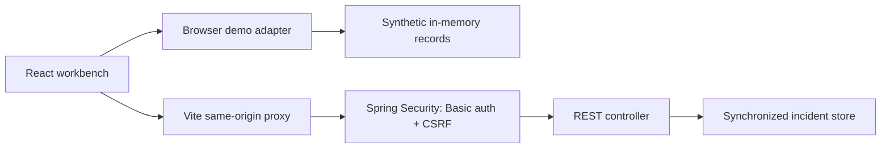

# Architecture and review notes

## Two explicit execution modes

The static preview uses the browser adapter. API mode runs locally and makes real HTTP requests to the Spring Boot service. The domain model is intentionally small so reviewers can inspect authorization, concurrency and audit boundaries without external infrastructure.

## API

| Method | Route | Access and behavior |
|---|---|---|
| GET | `/api/health` | Public liveness only |
| GET | `/api/session` | Authenticated user, operator permission and CSRF token |
| GET | `/api/summary` | Authenticated, counts over the whole dataset |
| GET | `/api/incidents?q=&status=&severity=&page=0&size=5` | Authenticated, filtered and paginated; max size 50 |
| GET | `/api/incidents/{id}` | Authenticated snapshot including audit history |
| PATCH | `/api/incidents/{id}` | Operator + valid CSRF token; body `{ "status": "INVESTIGATING", "version": 0, "note": "Investigating retries" }` |

Mutations reject stale versions with 409, illegal lifecycle jumps or blank/overlong notes with 400, and missing incidents with 404. Viewer writes fail with 403. Anonymous reads fail with 401. Roles and audit actor names come from the authenticated server principal rather than client-supplied actor fields.

## Why these choices

**Optimistic concurrency:** the user acts on the version they reviewed. The store checks it inside the same synchronization boundary as the update and audit append, so a second stale update fails. In a database, use `UPDATE ... WHERE id = ? AND version = ?`, check affected rows, and commit the audit entry in the same transaction.

**No fake durability:** an in-memory store keeps setup small but loses data on restart. It is not appropriate for real incident tracking. Database migration, backup/restore, retention, fine-grained tenancy and tamper-resistant audit export are future deployment concerns.

**Same-origin authentication:** local HTTP Basic is sufficient to exercise role checks, but production needs an identity provider, HTTPS, credential lifecycle and session policy. CSRF remains enabled. Vite proxies the API instead of allowing broad cross-origin requests. Demo passwords must not be reused elsewhere.

**Usable states:** search and filtering reset pagination; request cancellation prevents older searches replacing newer results. The UI includes loading, empty, failure and read-only states, semantic tables, labeled inputs, native modal focus handling, keyboard focus styles and responsive layouts. These design choices do not substitute for an accessibility audit with assistive technology.

## Further validation

Add database-backed concurrent integration tests, browser automation for connection/conflict flows, session expiry and logout behavior, request limits, security headers, telemetry, restore drills and representative load tests before deploying a real service. The current project makes no uptime, throughput or production-use claim.
